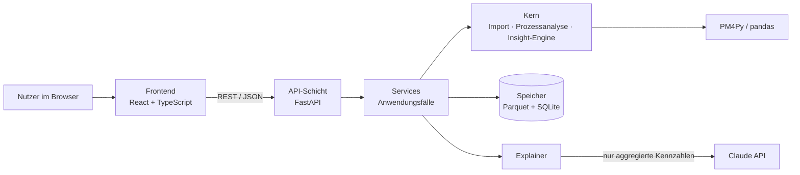
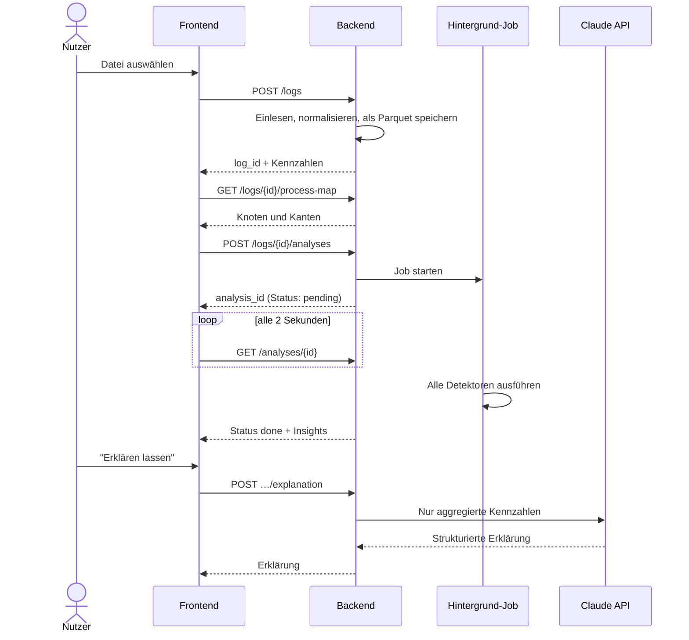

# Architektur: Process Insight

> Status: Entwurf v1 · Stand: September 2026
> Dieses Dokument beschreibt, aus welchen Bausteinen Process Insight besteht, wie sie zusammenarbeiten und warum sie so gewählt wurden. Es wird im Laufe des Projekts weiterentwickelt.

---

## 1. Ziel und Rahmenbedingungen

Process Insight ist ein Web-Tool, das Event-Logs (XES oder CSV) einliest, den Prozess als interaktive Prozesslandkarte darstellt, automatisch typische Prozessprobleme erkennt ("Insights") und diese auf Wunsch von einem Sprachmodell in verständlicher Sprache erklären lässt.

**Rahmenbedingungen**

- Ein Entwickler, ca. 3 Monate Umsetzung neben dem Studium
- Portfolio-Projekt: öffentlich auf GitHub, als Demo online erreichbar
- Betrieb kostenlos bzw. sehr günstig, ohne komplexe Infrastruktur
- Logs bis ca. 1,5 Mio. Events (Größenordnung BPI Challenge 2019)
- PM4Py steht unter AGPL-3.0, daher wird auch dieses Projekt unter AGPL-3.0 veröffentlicht

**Qualitätsziele (nach Priorität)**

| # | Ziel | Bedeutung |
|---|------|-----------|
| 1 | Nachvollziehbarkeit | Jede Aussage des Tools lässt sich bis zu den konkreten Fällen zurückverfolgen. Die KI formuliert nur, sie rechnet nicht. |
| 2 | Erweiterbarkeit | Ein neuer Detektor lässt sich hinzufügen, ohne bestehenden Code umzubauen. |
| 3 | Testbarkeit | Die gesamte Analyselogik ist ohne Web-Server, Datenbank oder KI testbar. |
| 4 | Einfacher Betrieb | Ein einziger Container, keine zusätzlichen Dienste. Das Tool funktioniert auch ohne KI. |
| 5 | Akzeptable Performance | Analyse des BPI-2019-Logs in unter einer Minute, Oberfläche bleibt dabei bedienbar. |

---

## 2. Überblick

**Architekturstil: modularer Monolith.** Das Backend ist *eine* Anwendung, die intern in klar getrennte Module aufgeteilt ist. Das Frontend ist eine eigenständige Single-Page-App, wird aber im selben Container ausgeliefert.



**Abhängigkeitsregel (wichtigste Regel der Architektur)**

```
api  →  services  →  core
             ↓
      storage, llm
```

- `api` kennt nur `services` (und Schemas).
- `services` verbinden `core`, `storage` und `llm` zu Anwendungsfällen.
- `core` kennt **nichts** davon: kein FastAPI, keine Datenbank, keine KI. Nur pandas und PM4Py.

Dadurch ist der Kern, in dem die eigentliche Intelligenz steckt, mit einfachen Unit-Tests prüfbar und könnte auch in einem Notebook oder Kommandozeilen-Tool wiederverwendet werden.

---

## 3. Bausteine

### 3.1 Frontend

**Technik:** React, TypeScript, Vite, TanStack Query (Datenabruf und Caching), Cytoscape.js mit dagre-Layout (Prozesslandkarte), Tailwind CSS.

**Seiten**

| Seite | Inhalt |
|-------|--------|
| Start | Datei hochladen oder Demo-Datensatz öffnen |
| Spaltenzuordnung | Nur bei CSV: Vorschau der ersten Zeilen, automatische Vorschläge für Case-ID, Aktivität, Zeitstempel, Ressource |
| Übersicht | Kennzahlen (Fälle, Events, Varianten, Durchlaufzeiten), Prozesslandkarte mit Detailgrad-Regler, Top-Varianten |
| Insights | Liste aller gefundenen Probleme, sortiert nach Schweregrad, filterbar nach Kategorie |
| Insight-Detail | Kennzahlen, betroffene Stelle in der Prozesslandkarte hervorgehoben, Tabelle der betroffenen Fälle, Button "Erklären lassen" |

**Regel:** Das Frontend enthält keine Analyselogik. Es zeigt an, was das Backend liefert.

### 3.2 API-Schicht (`backend/app/api`)

- FastAPI-Router, gruppiert nach Ressourcen (Logs, Analysen, Insights)
- Ein- und Ausgabeformate als Pydantic-Schemas; FastAPI erzeugt daraus automatisch eine API-Dokumentation (OpenAPI unter `/docs`)
- Aufgaben: Anfragen prüfen, Service aufrufen, Fehler in verständliche HTTP-Antworten übersetzen
- Enthält keine Geschäftslogik

### 3.3 Services (`backend/app/services`)

Jeder Service bildet einen Anwendungsfall ab:

- `LogService`: Upload annehmen, Format erkennen, Spaltenzuordnung anwenden, Log normalisieren und speichern
- `AnalysisService`: Analyse-Job anlegen, im Hintergrund ausführen, Ergebnis speichern und zwischenspeichern
- `ExplanationService`: Insight für die KI aufbereiten, Explainer aufrufen, Ergebnis zwischenspeichern

### 3.4 Kern (`backend/app/core`)

| Modul | Aufgabe |
|-------|---------|
| `importing` | XES und CSV einlesen und in das kanonische Format (Abschnitt 4.1) überführen |
| `process` | Kennzahlen, Prozesslandkarte (Directly-Follows-Graph mit Häufigkeiten und Wartezeiten), Varianten |
| `insights` | Insight-Engine und Detektoren (Abschnitt 5) |

Alle Funktionen im Kern sind "rein": Sie bekommen Daten und geben Ergebnisse zurück, ohne Dateien, Netzwerk oder Datenbank anzufassen.

### 3.5 Speicher (`backend/app/storage`)

- Hochgeladene Logs werden nach dem Einlesen als **Parquet**-Datei gespeichert
- Metadaten und Job-Status liegen in **SQLite**
- Analyseergebnisse werden als JSON-Datei gespeichert

Details in Abschnitt 9.

### 3.6 KI-Erklärungen (`backend/app/llm`)

- Schnittstelle `Explainer` mit zwei Implementierungen: `ClaudeExplainer` (echte API) und `FakeExplainer` (für Tests und Betrieb ohne API-Key)
- Prompts versioniert in einer eigenen Datei

Details in Abschnitt 6.

---

## 4. Datenmodell

### 4.1 Kanonisches Event-Log

Intern wird jedes Log als pandas-DataFrame mit den PM4Py-Standardspalten dargestellt. So ist keine Umwandlung nötig, wenn PM4Py-Funktionen aufgerufen werden.

| Spalte | Bedeutung | Pflicht |
|--------|-----------|---------|
| `case:concept:name` | Fall-ID (z.B. Bestellnummer) | ja |
| `concept:name` | Aktivität | ja |
| `time:timestamp` | Zeitpunkt, zeitzonenbewusst in UTC | ja |
| `org:resource` | Ausführende Person oder System | nein |
| weitere Spalten | Zusätzliche Attribute, unverändert übernommen | nein |

**Normalisierung beim Import**

1. Spalten gemäß Zuordnung umbenennen (bei XES bereits vorhanden)
2. Zeitstempel parsen und nach UTC umrechnen
3. Zeilen ohne Pflichtfelder entfernen; die Anzahl wird als Datenqualitätshinweis gespeichert
4. Nach Fall und Zeit sortieren

### 4.2 Log-Metadaten (SQLite-Tabelle `logs`)

`id` (UUID), `name`, `source_format` (xes/csv), `uploaded_at`, `n_events`, `n_cases`, `n_activities`, `has_resource`, `dropped_rows`, `is_demo`, `status`

### 4.3 Analyse-Jobs (SQLite-Tabelle `analyses`)

`id` (UUID), `log_id`, `config_hash`, `config_json`, `status` (pending / running / done / failed), `started_at`, `finished_at`, `error_message`, `result_path`

### 4.4 Insight

Alle Detektoren liefern Ergebnisse in genau diesem Format:

```python
class Insight(BaseModel):
    id: str
    detector_id: str
    category: Literal["efficiency", "quality", "compliance", "deviation"]
    severity: Literal["low", "medium", "high"]
    title: str                      # z.B. "Häufige Nacharbeit bei 'Rechnung prüfen'"
    summary: str                    # deterministischer Text aus einer Vorlage
    metrics: dict[str, float | int | str]
    evidence: dict[str, Any]        # z.B. betroffene Aktivitäten oder Übergänge
    affected_case_count: int
    affected_case_share: float      # Anteil an allen Fällen, 0–1
    affected_case_ids: list[str]    # gekürzt auf max. 500, Rest über API abrufbar
```

**Konvention:** Bezeichner im Code sind englisch, Texte in der Oberfläche und die Dokumentation deutsch.

---

## 5. Insight-Engine

### 5.1 Prinzip

Jeder Detektor ist eine eigenständige Klasse mit derselben Schnittstelle. Die Engine kennt die Detektoren nur über diese Schnittstelle.

```python
class Detector(ABC):
    id: ClassVar[str]
    name: ClassVar[str]
    category: ClassVar[str]
    required_columns: ClassVar[set[str]]
    config_model: ClassVar[type[BaseModel]]

    @abstractmethod
    def detect(self, log: pd.DataFrame, config: BaseModel) -> list[Insight]:
        ...
```

### 5.2 Ablauf in der Engine

Für jeden registrierten Detektor:

1. Prüfen, ob die benötigten Spalten vorhanden sind. Wenn nicht: Status "nicht anwendbar" (z.B. Vier-Augen-Prüfung ohne Ressourcenspalte)
2. Konfiguration mit dem Pydantic-Modell des Detektors validieren (Standardwerte, wenn nichts angegeben)
3. Detektor ausführen, Laufzeit messen, Fehler abfangen. Ein fehlerhafter Detektor bricht nicht die ganze Analyse ab
4. Ergebnisse sammeln

Danach werden alle Insights nach Schweregrad und Anteil betroffener Fälle sortiert.

**Ergebnis einer Analyse**

```python
class AnalysisResult(BaseModel):
    log_summary: LogSummary
    insights: list[Insight]
    detector_runs: list[DetectorRun]   # id, status, duration_ms, error
```

### 5.3 Detektoren in Version 1

| ID | Frage | Kernidee | Konfiguration | Benötigte Spalten |
|----|-------|----------|---------------|-------------------|
| `rework` | Werden Arbeitsschritte wiederholt? | Pro Fall zählen, wie oft jede Aktivität vorkommt; mehr als einmal = Nacharbeit | Mindestanteil betroffener Fälle | Fall, Aktivität |
| `bottleneck` | Wo wird am längsten gewartet? | Wartezeit je direktem Übergang A → B (Median, Summe, Anteil an Gesamtdurchlaufzeit) | Mindesthäufigkeit des Übergangs, Anzahl Top-Ergebnisse | + Zeitstempel |
| `sla` | Welche Fälle dauern zu lange? | Durchlaufzeit über einem Schwellenwert | fester Wert in Tagen **oder** Perzentil (Standard: 90 %) | + Zeitstempel |
| `segregation_of_duties` | Wird das Vier-Augen-Prinzip verletzt? | Dieselbe Ressource führt beide Aktivitäten eines konfigurierten Paares im selben Fall aus | Liste von Aktivitätspaaren | + Ressource |
| `rare_variants` | Welche Fälle weichen vom Standard ab? | Varianten mit sehr geringem Anteil, zusammengefasst | Schwellenwert für den Variantenanteil | Fall, Aktivität, Zeitstempel |

### 5.4 Schweregrad

Der Schweregrad wird regelbasiert und transparent berechnet. Jeder Detektor dokumentiert seine Regel, und die Oberfläche zeigt sie an. Beispiel `rework`: "hoch", wenn mindestens 20 % der Fälle betroffen sind, "mittel" ab 5 %, sonst "niedrig". Compliance-Verstöße sind ab dem ersten Fall mindestens "mittel".

### 5.5 Einen neuen Detektor hinzufügen

1. Neue Datei in `core/insights/detectors/` mit einer Klasse, die von `Detector` erbt
2. Eintrag in der Registry (`core/insights/registry.py`)
3. Tests mit einem kleinen, von Hand gebauten Log, dessen richtiges Ergebnis bekannt ist

Kein anderer Code muss angepasst werden.

---

## 6. KI-Erklärungen

**Grundsatz: Das Sprachmodell formuliert, es rechnet nicht.** Alle Zahlen stammen aus den Detektoren.

**Was das Modell bekommt**

- Titel, Kategorie, Schweregrad, Kennzahlen und Evidenz *eines* Insights
- Aktivitätsnamen
- **Keine** Rohdaten, **keine** Fall-IDs, Ressourcennamen nur pseudonymisiert ("Ressource A")

**Was das Modell zurückgibt** (strukturiertes JSON, mit Pydantic validiert)

```json
{
  "headline": "…",
  "explanation": "…",
  "possible_causes": ["… (Hypothese)"],
  "next_steps": ["…"]
}
```

**Schutzmechanismen**

- Mögliche Ursachen werden ausdrücklich als Hypothesen gekennzeichnet
- Ungültige Antwort: ein erneuter Versuch, danach Rückfall auf den deterministischen `summary`-Text
- Optional: Prüfung, ob alle Zahlen in der Antwort auch in den Kennzahlen vorkommen
- Erklärungen werden nur auf Klick erzeugt und über einen Hash (Insight + Prompt-Version) zwischengespeichert
- Begrenzung der Anfragen pro Zeitraum und der maximalen Antwortlänge, um Kosten der öffentlichen Demo zu kontrollieren
- Das verwendete Modell ist per Konfiguration einstellbar, nicht fest im Code

**Ohne API-Key** läuft das Tool vollständig; statt der KI-Erklärung wird der `summary`-Text angezeigt.

---

## 7. API

Alle Endpunkte liegen unter `/api`.

| Methode | Pfad | Zweck |
|---------|------|-------|
| `POST` | `/logs` | Datei hochladen. Antwort: `log_id`, erkanntes Format, bei CSV Spaltenvorschau und Zuordnungsvorschlag |
| `POST` | `/logs/{log_id}/mapping` | Spaltenzuordnung für CSV festlegen und Log normalisieren |
| `GET` | `/logs/{log_id}` | Metadaten und Kennzahlen |
| `GET` | `/logs/{log_id}/process-map` | Prozesslandkarte als Knoten und Kanten (Parameter: Detailgrad, Häufigkeit oder Wartezeit) |
| `GET` | `/logs/{log_id}/variants` | Häufigste Varianten |
| `POST` | `/logs/{log_id}/analyses` | Analyse mit Konfiguration starten. Antwort: `analysis_id` |
| `GET` | `/analyses/{analysis_id}` | Status und, wenn fertig, Ergebnis |
| `GET` | `/analyses/{analysis_id}/insights/{insight_id}/cases` | Betroffene Fälle, seitenweise |
| `POST` | `/analyses/{analysis_id}/insights/{insight_id}/explanation` | KI-Erklärung anfordern |
| `GET` | `/demo` | ID des vorinstallierten Demo-Logs |
| `GET` | `/health` | Lebenszeichen für Monitoring |

---

## 8. Ablauf: vom Upload bis zur Anzeige



1. Der Nutzer lädt eine Datei hoch.
2. Das Backend prüft Größe und Format, liest die Datei ein, normalisiert sie und speichert sie als Parquet. Bei CSV folgt vorher die Spaltenzuordnung.
3. Das Frontend zeigt sofort Kennzahlen und Prozesslandkarte, die schnell berechnet sind.
4. Parallel startet die Analyse als Hintergrund-Job. Das Frontend fragt regelmäßig den Status ab.
5. Ist die Analyse fertig, erscheinen die Insights.
6. Auf Wunsch wird für ein Insight eine KI-Erklärung erzeugt.

---

## 9. Speicherung und Lebenszyklus

```
storage/
├── app.db                       # SQLite: Logs, Analysen
├── logs/{log_id}/
│   ├── original.xes | .csv      # Originaldatei
│   └── events.parquet           # Normalisiertes Log
└── analyses/{analysis_id}.json  # Analyseergebnis
```

- **Zwischenspeicherung:** Wird dieselbe Analyse (gleiches Log, gleiche Konfiguration, erkennbar am `config_hash`) erneut angefragt, wird das gespeicherte Ergebnis geliefert.
- **Aufräumen:** In der öffentlichen Demo werden hochgeladene Logs nach 24 Stunden gelöscht. Das Demo-Log ist davon ausgenommen.
- **Neustart:** Jobs, die beim Neustart noch als "running" markiert sind, werden auf "failed" gesetzt und können neu gestartet werden.

---

## 10. Performance

- Berechnungen mit vektorisierten pandas-Operationen, keine Python-Schleifen über einzelne Events
- Log wird pro Job einmal aus Parquet geladen und an alle Detektoren weitergegeben
- Analysen laufen als Hintergrund-Job, damit Anfragen nicht in ein Zeitlimit laufen
- Prozesslandkarte wird serverseitig auf die häufigsten Pfade reduziert (Detailgrad-Regler), damit sie lesbar bleibt
- Konfigurierbare Grenzen: maximale Dateigröße (Standard 200 MB), maximale Anzahl Events (Standard 2 Mio.)
- Laufzeit jedes Detektors wird protokolliert, um Engpässe im eigenen Code zu finden

---

## 11. Sicherheit und Datenschutz

- **Keine Benutzerkonten.** Logs sind nur über ihre zufällige UUID erreichbar. Das ist keine echte Zugriffskontrolle; die Oberfläche weist deshalb deutlich darauf hin, keine sensiblen Daten hochzuladen.
- **Upload-Prüfung:** Dateiendung, Größe, Lesbarkeit. Fehler führen zu einer verständlichen Fehlermeldung statt eines Absturzes.
- **XML-Sicherheit:** XES-Dateien werden ohne Auflösung externer Entitäten gelesen (Schutz vor XXE-Angriffen). Offener Punkt: Verhalten von PM4Py prüfen, gegebenenfalls vorher mit `defusedxml` validieren.
- **Geheimnisse:** API-Keys nur in einer `.env`-Datei bzw. in Umgebungsvariablen, nie im Code oder in Git. Einlesen mit `pydantic-settings`.
- **KI:** erhält keine Rohdaten und keine Fall-IDs; Ressourcennamen werden pseudonymisiert.
- **Kostenschutz:** Anfragebegrenzung für den Erklärungs-Endpunkt.

---

## 12. Qualität, Tests und Konventionen

**Tests**

- Unit-Tests für den Kern mit kleinen, von Hand gebauten Logs (z.B. drei Fälle, einer davon mit Nacharbeit), bei denen das richtige Ergebnis vorher bekannt ist
- Vergleich von Kennzahlen mit PM4Py-Ergebnissen als Referenz
- Integrationstests der API mit dem FastAPI-`TestClient`
- `FakeExplainer` statt echter KI in allen Tests

**Werkzeuge**

- Backend: pytest, Ruff (Linting und Formatierung), später optional mypy
- Frontend: ESLint, Prettier
- pre-commit-Hooks, damit Formatierung und Linting vor jedem Commit laufen

**Continuous Integration (GitHub Actions)** bei jedem Push: Linting, Backend-Tests, Frontend-Build.

**Konventionen**

- Code und Bezeichner englisch, Oberfläche und Dokumentation deutsch
- Konfiguration ausschließlich über Umgebungsvariablen
- Architekturentscheidungen werden in `docs/ENTSCHEIDUNGEN.md` festgehalten

---

## 13. Projektstruktur

```
process-insight/
├── backend/
│   ├── app/
│   │   ├── main.py                 # FastAPI-App, liefert auch das Frontend aus
│   │   ├── config.py               # Einstellungen aus Umgebungsvariablen
│   │   ├── api/                    # Router und Schemas
│   │   ├── services/               # LogService, AnalysisService, ExplanationService
│   │   ├── core/
│   │   │   ├── importing/          # xes.py, csv.py, normalize.py
│   │   │   ├── process/            # stats.py, process_map.py, variants.py
│   │   │   └── insights/
│   │   │       ├── base.py         # Detector, Insight
│   │   │       ├── engine.py
│   │   │       ├── registry.py
│   │   │       └── detectors/      # rework.py, bottleneck.py, sla.py, …
│   │   ├── llm/                    # explainer.py, claude_explainer.py, prompts.py
│   │   └── storage/                # database.py, files.py
│   ├── tests/
│   │   ├── fixtures/               # kleine Test-Logs
│   │   ├── unit/
│   │   └── integration/
│   └── requirements.txt
├── frontend/
│   └── src/
│       ├── pages/
│       ├── components/
│       └── api/                    # Funktionen für Backend-Aufrufe
├── notebooks/                      # Datenerkundung (Phase 1)
├── data/                           # Datensätze, nicht in Git
├── docs/
├── Dockerfile
├── docker-compose.yml
├── .github/workflows/ci.yml
├── CLAUDE.md
└── README.md
```

---

## 14. Deployment

- **Ein Docker-Image**, mehrstufig gebaut: Stufe 1 baut das Frontend zu statischen Dateien, Stufe 2 enthält das Python-Backend, das unter `/api` die Schnittstelle und unter `/` das Frontend ausliefert
- `docker-compose.yml` für die lokale Entwicklung
- Speicherordner als Volume, damit Daten einen Neustart überleben
- Konfiguration über Umgebungsvariablen (API-Key, Grenzen, Aufbewahrungsdauer)
- Betrieb auf einem kleinen Cloud-Server oder einer Container-Plattform
- **Demo-Log vorinstalliert**, damit Besucher das Tool sofort ausprobieren können, ohne eigene Daten hochzuladen

---

## 15. Architekturentscheidungen (Kurzfassung)

| # | Entscheidung | Verworfene Alternativen | Begründung |
|---|--------------|-------------------------|------------|
| 1 | Modularer Monolith | Microservices | Ein Entwickler, einfacher Betrieb; Modulgrenzen sind trotzdem klar |
| 2 | REST mit JSON | GraphQL | Einfach, gut verstanden, automatische Dokumentation durch FastAPI |
| 3 | Parquet + SQLite | PostgreSQL; nur Arbeitsspeicher | Keine zusätzliche Infrastruktur, schnell, übersteht Neustarts |
| 4 | FastAPI-Hintergrundaufgaben + Polling | Celery + Redis; WebSockets | Reicht für Version 1, keine weiteren Dienste nötig |
| 5 | Prozesslandkarte als JSON, Darstellung mit Cytoscape.js | Graphviz-Bild vom Server | Interaktiv (klicken, filtern, hervorheben) |
| 6 | KI nur auf aggregierten Ergebnissen | KI analysiert Rohdaten | Keine erfundenen Zahlen, Datenschutz, geringe Kosten |
| 7 | PM4Py-Standardspalten als internes Format | Eigenes Format | Keine Umwandlung, direkte Nutzung von PM4Py |
| 8 | Ein Container für Frontend und Backend | Getrennte Bereitstellung | Ein Dienst, keine CORS-Konfiguration |
| 9 | Tool funktioniert ohne KI | KI als Pflichtbestandteil | Robustheit, Demo auch ohne API-Kosten |

---

## 16. Risiken und offene Fragen

| Thema | Risiko / Frage | Umgang |
|-------|----------------|--------|
| Speicherbedarf | Große Logs könnten in pandas mehrere GB belegen | In Phase 1 mit BPI 2019 messen; ggf. Spalten beim Laden einschränken |
| Schwellenwerte | Zu viele oder zu wenige Insights | Perzentil-basierte Standardwerte, konfigurierbar; an echten Daten kalibrieren |
| Vier-Augen-Paare | Welche Aktivitätspaare sind sinnvoll? | Konfigurierbar; Standardpaare für den Einkaufsprozess (BPI 2019) |
| XES-Sicherheit | XXE-Angriffe über präparierte Dateien | PM4Py-Verhalten prüfen, ggf. `defusedxml` |
| KI-Fehler | Modell erfindet trotz Vorgaben Aussagen | Strukturierte Ausgabe, Zahlenprüfung, Kennzeichnung als Hypothese |
| Zeitzonen | Uneinheitliche Zeitangaben in CSV-Dateien | Beim Import nach UTC umrechnen, Annahme in der Oberfläche anzeigen |
| Lizenz | AGPL-Pflichten durch PM4Py | Projekt selbst unter AGPL-3.0 veröffentlichen |

---

## 17. Umsetzungsreihenfolge

| Phase | Inhalt | Ergebnis |
|-------|--------|----------|
| 1 | Datenerkundung in Notebooks | Verständnis der Daten, erste Detektor-Ideen |
| 2 | Backend-Grundgerüst: Projektstruktur, Tests, CI, Import, Kennzahlen, Prozesslandkarte | API liefert Kennzahlen und Graph |
| 3 | Insight-Engine und Detektoren | Analyse findet Probleme |
| 4 | Frontend | Bedienbares Tool im Browser |
| 5 | KI-Erklärungen | Verständliche Erklärungen per Klick |
| 6 | Docker, Deployment, Demo-Log, README, Fallstudie | Öffentlich erreichbare Demo |
